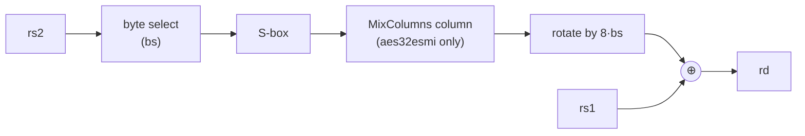

# AES-128 acceleration on a RISC-V core

Custom AES instructions for the open-source **CV32E40P (RI5CY)** RISC-V core, compiler support for them in **LLVM/Clang**, and AES software rewritten to use them, running on a PYNQ FPGA board. One encryption is **116× faster** than the course baseline, for 2.3% more LUTs.

Group project for the TU Delft MSc course *Processor Design Project* (CESE4040), 2025–2026, by **Sofie Vos**, **Matteo Tornar**, **Adhiraj Kaushik** and **João Firta Foes**. We started from the course template: the unmodified core, the FPGA system and a plain software AES-128 benchmark.

## What we built

- **`aes32esi` / `aes32esmi`** from the RISC-V scalar crypto extension (Zkne), added to the ALU. Each one runs a byte of `rs2` through an S-box, applies one MixColumns column (`aes32esmi` only), rotates the result into place and XORs it with `rs1`, in a single cycle. One AES round takes 16 of them.
- **`custom_keygen_f rd, rs1, round`**, a custom single-cycle instruction for the key-schedule function `SubWord(RotWord(w)) ⊕ Rcon[round]`, using four S-boxes.
- **Compiler support:** a Clang builtin, `__builtin_riscv_ksu_f`, lowered through a new LLVM intrinsic to the custom instruction, with a compile-time check that the round is 1–10.
- **Optimised software** that uses the new instructions for both the rounds and the key expansion, with tuned compiler flags.



## Results

Cycles were measured with the `mcycle` counter on the FPGA, with the core at 20 MHz.

| Version (`software/Final_codes/`) | Change | Key expansion | Total cycles | Speed-up |
|---|---|---:|---:|---:|
| `original` | software AES with S-box tables | 2,399 | 68,429 | 1× |
| `Mandatory_AES` | rounds use `aes32esmi`/`aes32esi`, loops unrolled | 2,135 | 4,156 | 16.5× |
| `NoBuiltins` | + key expansion with the custom instruction (inline assembly) | 1,432 | 3,528 | 19.4× |
| `Builtins` | + custom instruction through the new compiler builtin | 794 | 2,890 | 23.7× |
| `final_version` | + aggressive inlining, `-O2` and post-RA scheduling | – | **591** | **116×** |

MixColumns took 85% of the original cycles. The AES instructions cut the encryption itself from 66,030 to 1,143 cycles, which left key expansion as the bottleneck. The custom instruction makes key expansion 2.7× faster, and compiler inlining and scheduling gave another 4.9×. One encryption went from 3.42 ms to 29.6 µs.

The final design uses 235 more LUTs than the original (10,406 vs 10,171, +2.3%) and still has 26.3 ns of slack on the 50 ns clock, so it could run at about 42 MHz.

**What didn't work:** unrolling the AES loops barely mattered (4,163 → 4,156 cycles), because this in-order core hides the loop overhead. Generating the round keys in parallel gave no speed-up on a single-issue core, and the keys no longer followed the AES standard.

## Repository layout

```text
hardware/src/design/riscy/     CV32E40P core with the AES units (ALU, S-box, key expansion, decoder)
hardware/src/simulation/       testbench
hardware/src/sw/fpga/riscy/    notebook, bitstream and memory files for the board
hardware/scripts/              Vivado Tcl scripts
software/final_version.c       optimised AES-128
software/Final_codes/          every version in the results table
software/llvm_modifications/   changed LLVM/Clang files (Positions.md says where each goes)
```

## Building and running

You need Vivado 2024.2, the RISC-V GNU toolchain and an LLVM build with the files from `software/llvm_modifications/`. Building only the RISC-V target is enough (`-DLLVM_TARGETS_TO_BUILD=RISCV -DLLVM_ENABLE_PROJECTS="clang;lld"`).

1. **Software:** set your GCC and LLVM paths in `software/config/rv32-standard.conf`, then run `make soft` in `software/`. It builds `final_version.c` into `software/bin_files/code.coe` and `data.coe`. Add `FILE=Final_codes/...` to build another version. To reproduce the final result, change `-O1` to `-O2` on line 21 of the Makefile and enable the `-mllvm` flags on line 22.
2. **Simulation and bitstream:** in the Vivado Tcl console, inside `hardware/`, run `source ./scripts/create_project.tcl`, then `run_simulation.tcl` to simulate or `run_synth_impl.tcl` to build a bitstream.
3. **On the board:** copy `hardware/src/sw/fpga/riscy/` to the board's Jupyter home and run `base_riscy.ipynb`. The included bitstream is our final demo build (12 June 2026), and it runs every version in `Final_codes/`.

The program checks its own result. It writes `0xCAFEBABE` (pass) or `0xBAAAAAAD` (fail) to data memory, then `0xDEADBEEF` when it has finished.

## Design notes

The key-expansion instruction uses major opcode `0x6B` (`OPC_CUSTOM_4` in LLVM). In the base RISC-V opcode map this is a reserved slot, because the core already uses the custom slots for PULP instructions. The Zkne encodings would also overlap PULP's `p.extract`, but this build sets `PULP_XPULP = 0`, so there is no conflict.

## My contribution

- **AES instructions in the core** (with Matteo): `aes32esi`/`aes32esmi`, including the S-box, ALU datapath, decoder and pipeline wiring, up to the first version that passed the testbench.
- **Loop unrolling and compiler settings** (with Matteo): showed that unrolling barely matters on this core.
- **Evaluation:** chose the metrics (cycles per function, timing slack, resource usage, area-delay product) and re-measured the baseline after the mandatory AES instructions.
- **Power analysis** (with Adhiraj): a SAIF simulation flow for Vivado power estimates. We dropped energy as a metric because the ARM processing system dominated it.
- **DMA and clock study:** showed DMA wasn't worth it. Memory accesses were only 17% of the cycles, so DMA could give at most about 1.2×, and the data already sits in local BRAM. I raised the fabric clock instead. It met timing but isn't in the final design.
- **S-box study:** showed that a separate S-box instruction wasn't worth adding.
- **Integration and presentation:** merged the final version into `main` (with Matteo and Adhiraj) and presented the results.

## Acknowledgements

- [CV32E40P](https://github.com/openhwgroup/cv32e40p) by the OpenHW Group, originally RI5CY by ETH Zurich and the University of Bologna. It is licensed under the Solderpad Hardware License 0.51 (`hardware/src/design/riscy/LICENSE`), and the original licence headers are kept.
- The FPGA system, Vivado scripts, testbench, notebook and baseline AES code come from the TU Delft course staff.
- `software/include/spr-defs.h` comes from the OpenRISC toolchain (GPL-3.0-or-later). The files in `software/llvm_modifications/` are modified LLVM sources (Apache-2.0 with LLVM exceptions).